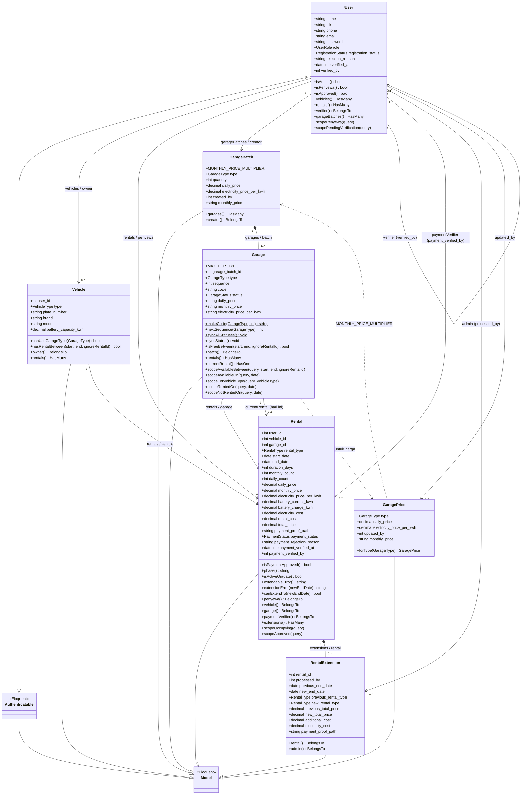
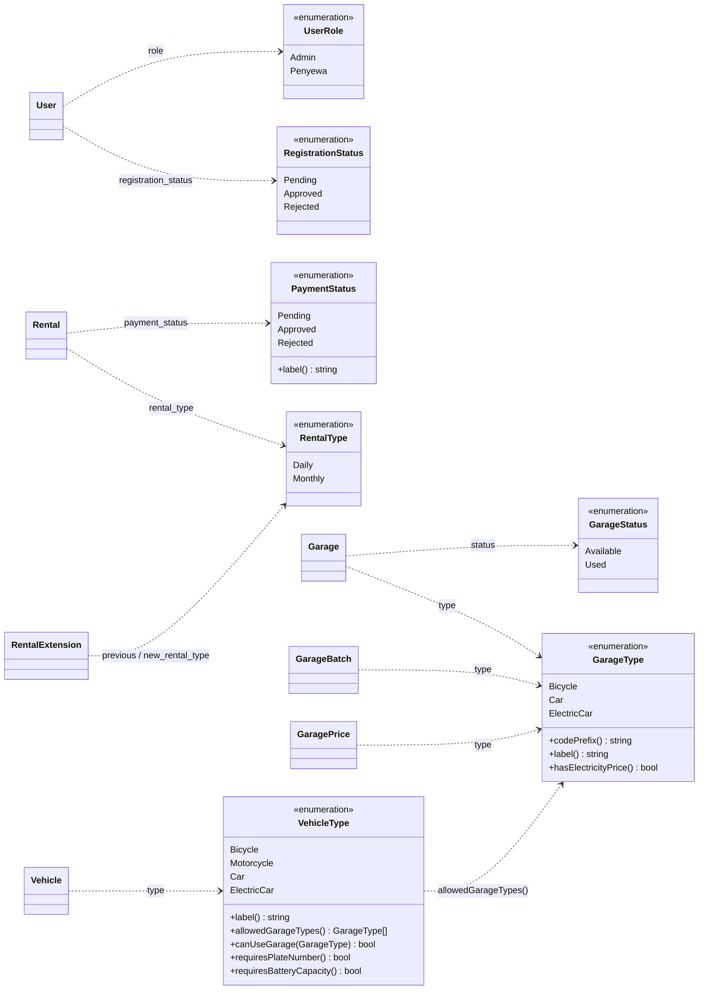
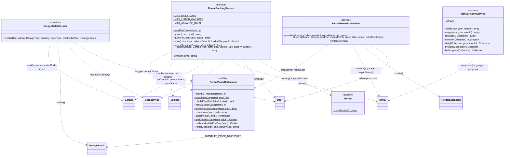
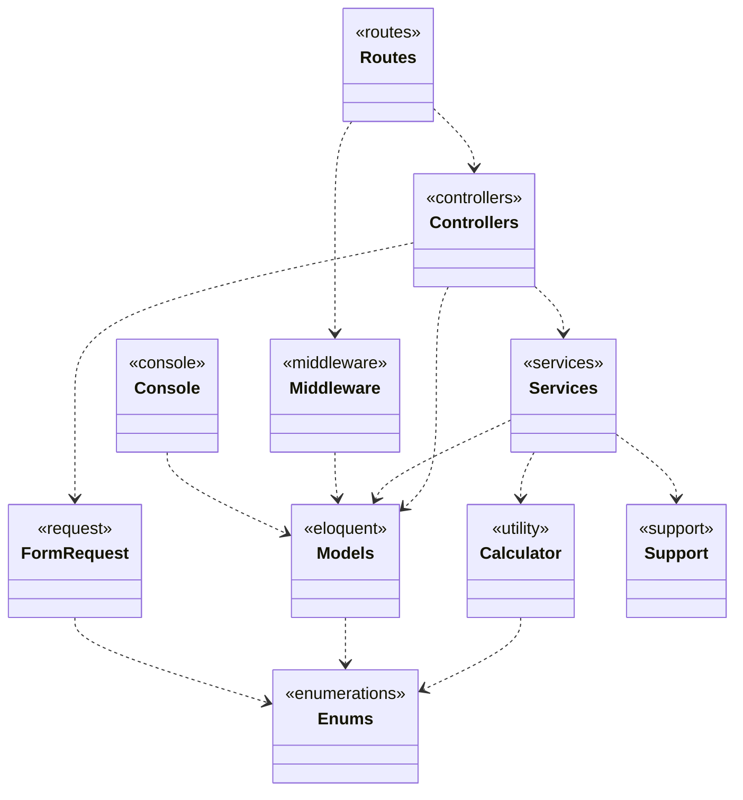

# Class Diagram Garage Rental

Class diagram ini disusun dari kode di `app/` (Model, Enum, Service, Support, Controller, Middleware, Form Request, Console Command, Provider). Karena aplikasinya cukup besar, diagram dibagi per lapisan supaya mudah dibaca:

| # | Diagram | Isi |
|---|---|---|
| 1 | Domain model | Model Eloquent beserta atribut, method, dan relasinya |
| 2 | Enum | Semua enum, nilai (case), dan method-nya, termasuk siapa yang memakainya |
| 3 | Service & support | Logika bisnis (`app/Services`, `app/Support`) dan ketergantungannya |
| 4 | HTTP layer | Controller, middleware, form request, dan service yang dipakai |
| 5 | Console & provider | Scheduler `garages:sync-status` dan direktif Blade `@rupiah` |
| 6 | Gambaran keseluruhan | Ringkasan antar-lapisan (hanya nama kelas) |

Notasi yang dipakai:

- `-->` asosiasi (relasi Eloquent / foreign key), `*--` komposisi (anak tidak berarti tanpa induk), `..>` ketergantungan (dipakai oleh method), `--|>` pewarisan.
- `+` public, `-` private, `$` static (ditulis di akhir signature), `<<enumeration>>` untuk enum PHP, `<<service>>`, `<<middleware>>`, dan seterusnya sebagai stereotip.
- Atribut model adalah kolom tabel (lihat [ERD](erd.md)). Kolom `id`, `created_at`, `updated_at` tidak ditampilkan.
- Accessor Eloquent (`getXAttribute`) ditulis sebagai atribut virtual, misalnya `monthly_price`.

---

## 1. Domain model

Semua model mewarisi `Illuminate\Database\Eloquent\Model`, kecuali `User` yang mewarisi `Authenticatable`. Cast ke enum ditulis pada tipe atributnya.



Catatan desain pada diagram 1:

- **Satu `GaragePrice` per tipe garasi.** Harga aktif disimpan di `garage_prices` (unik per `type`). `GarageBatch` menyimpan harga saat batch dibuat sebagai arsip, sedangkan `Garage` tidak punya kolom harga sendiri: accessor `daily_price`, `monthly_price`, `electricity_price_per_kwh` membaca `GaragePrice::forType()`.
- **`Rental` menyalin harga** (`daily_price`, `monthly_price`, `electricity_price_per_kwh`) saat transaksi dibuat, sehingga perubahan harga di kemudian hari tidak mengubah sewa lama.
- **`User` punya tiga peran relasi ke admin**: `verified_by` (verifikasi pendaftaran), `payment_verified_by` (verifikasi bukti bayar `Rental`), dan `processed_by` (perpanjangan sewa). Relasi `User` ke dirinya sendiri (`verifier`) juga ada.
- **Garasi terisi** ditentukan oleh `Rental` dengan `scopeOccupying` (status bayar bukan `rejected`) yang rentang tanggalnya beririsan; `Garage::syncStatus()` dan `syncAllStatuses()` menyelaraskan kolom `status`.
- `Vehicle.plate_number` tidak unik lagi (migrasi `drop_unique_plate_number_on_vehicles`), jadi tidak ada relasi/constraint unik pada kolom itu.

---

## 2. Enum



Aturan kecocokan kendaraan dan garasi (`VehicleType::allowedGarageTypes()`):

| Tipe kendaraan | Tipe garasi yang boleh | Kode garasi | Plat nomor wajib | Kapasitas baterai wajib |
|---|---|---|---|---|
| `Bicycle` | `Bicycle` | `S###` | tidak | tidak |
| `Motorcycle` | `Bicycle` | `S###` | ya | tidak |
| `Car` | `Car` | `C###` | ya | tidak |
| `ElectricCar` | `Car`, `ElectricCar` | `C###` / `E###` | ya | ya |

`PaymentStatus::Rejected` adalah satu-satunya status yang **tidak** menahan garasi (`Rental::scopeOccupying`). `RegistrationStatus` dan `PaymentStatus` punya nilai yang sama tetapi dipakai pada konteks berbeda (pendaftaran penyewa vs bukti bayar sewa).

---

## 3. Service & support

Logika bisnis ada di service yang dipanggil controller. `RentalPeriodCalculator` dan `Format` berisi method static murni tanpa state.



Alur bisnis utama di lapisan ini:

- **Sewa baru** (`RentalBookingService::book`): dalam satu transaksi DB, garasi dikunci (`lockForUpdate`), `quote()` dijalankan ulang sebagai validasi akhir, kendaraan dibuat bila baru, `Rental` dibuat dengan `payment_status = Pending`, bukti bayar disimpan di `payment-proofs`, lalu `Garage::syncStatus()`.
- **Hitung biaya** (`RentalPeriodCalculator::rentalCost`): durasi >= jumlah hari dalam bulan awal dihitung 1 bulan (25 x harga harian) ditambah sisa hari harian; selain itu semua harian.
- **Biaya listrik** (`RentalBookingService::costs`): hanya bila garasi `ElectricCar` **dan** kendaraan `ElectricCar`. Rumusnya `(kapasitas baterai - sisa baterai) x harga per kWh`, dibayar sekali di awal.
- **Perpanjangan** (`RentalExtensionService::extend`): hanya oleh admin; mencatat riwayat di `RentalExtension` (tanggal, tipe, total lama/baru, biaya tambahan) lalu memperbarui `Rental`.
- **Batch garasi** (`GarageBatchService::create`): membuat `GarageBatch`, memperbarui `GaragePrice` untuk tipe itu, dan menyisipkan `quantity` garasi dengan kode berurutan (`S001`, `C010`, `E123`), maksimal 999 per tipe.
- **Laporan** (`RentalReportService::build`): hanya sewa dengan pembayaran `Approved`, dikelompokkan per bulan, per hari, per tipe garasi, atau per penyewa.

---

## 4. HTTP layer

Semua controller mewarisi `Controller` (kelas dasar kosong). Controller tipis: validasi dan alur halaman di controller, aturan bisnis didelegasikan ke service dan model.

```mermaid
classDiagram
    direction LR

    class Controller {
        <<abstract>>
    }

    class AuthController {
        +showLogin() View
        +login(Request) RedirectResponse
        +logout(Request) RedirectResponse
    }

    class RegisterController {
        +show() View
        +store(Request) RedirectResponse
    }

    class PasswordResetController {
        +request() View
        +email(Request) RedirectResponse
        +reset(Request, token) View
        +update(Request) RedirectResponse
    }

    namespace Admin {
        class AdminDashboardController {
            <<Admin>>
            +__invoke() View
        }
        class AdminGarageController {
            <<Admin>>
            +index(Request) View
            +create() View
            +store(Request, GarageBatchService) RedirectResponse
        }
        class AdminRegistrationController {
            <<Admin>>
            +index(Request) View
            +approve(Request, User) RedirectResponse
            +reject(Request, User) RedirectResponse
            -decide(Request, User, RegistrationStatus, reason) RedirectResponse
        }
        class AdminRentalController {
            <<Admin>>
            +FILTERS$
            +index(Request) View
            +show(Request, Rental, RentalExtensionService) View
            +approve(Request, Rental) RedirectResponse
            +reject(Request, Rental) RedirectResponse
            +extend(Request, Rental, RentalExtensionService) RedirectResponse
            +destroy(Rental) RedirectResponse
            -decide(Request, Rental, PaymentStatus, reason) RedirectResponse
        }
        class AdminReportController {
            <<Admin>>
            +__invoke(Request, RentalReportService) View
        }
    }

    namespace Penyewa {
        class PenyewaDashboardController {
            <<Penyewa>>
            +__invoke(Request) View
        }
        class PenyewaProfileController {
            <<Penyewa>>
            +edit(Request) View
            +update(Request) RedirectResponse
        }
        class PenyewaRentalController {
            <<Penyewa>>
            +index(Request) View
            +create(Request) View
            +quote(Request, RentalBookingService) JsonResponse
            +store(StoreRentalRequest, RentalBookingService) RedirectResponse
            +show(Request, Rental) View
        }
    }

    class StoreRentalRequest {
        <<FormRequest>>
        +authorize() bool
        +rules() array
        +vehicleData() array
        #prepareForValidation() void
    }

    class EnsureAdmin {
        <<middleware>>
        +handle(Request, Closure) Response
    }
    class EnsurePenyewa {
        <<middleware>>
        +handle(Request, Closure) Response
    }
    class EnsureApproved {
        <<middleware>>
        +handle(Request, Closure) Response
    }

    class FormRequest {
        <<Laravel>>
    }

    class GarageBatchService
    class RentalBookingService
    class RentalExtensionService
    class RentalReportService

    class User
    class Garage
    class GaragePrice
    class Rental

    AuthController --|> Controller
    RegisterController --|> Controller
    PasswordResetController --|> Controller
    AdminDashboardController --|> Controller
    AdminGarageController --|> Controller
    AdminRegistrationController --|> Controller
    AdminRentalController --|> Controller
    AdminReportController --|> Controller
    PenyewaDashboardController --|> Controller
    PenyewaProfileController --|> Controller
    PenyewaRentalController --|> Controller
    StoreRentalRequest --|> FormRequest

    PenyewaRentalController ..> StoreRentalRequest : validasi store()
    AdminGarageController ..> GarageBatchService
    AdminRentalController ..> RentalExtensionService
    AdminReportController ..> RentalReportService
    PenyewaRentalController ..> RentalBookingService

    AdminDashboardController ..> Garage
    AdminDashboardController ..> Rental
    AdminDashboardController ..> User
    AdminGarageController ..> Garage
    AdminGarageController ..> GaragePrice
    AdminRegistrationController ..> User
    AdminRentalController ..> Rental
    AdminReportController ..> Rental
    RegisterController ..> User
    PenyewaRentalController ..> Rental
    PenyewaProfileController ..> User

    EnsureAdmin ..> User : isAdmin()
    EnsurePenyewa ..> User : isPenyewa()
    EnsureApproved ..> User : isApproved()
```



Pemetaan rute ke controller dan middleware (`routes/web.php`):

| Grup rute | Middleware | Controller |
|---|---|---|
| `/login`, `/register`, `/forgot-password`, `/reset-password` | `guest` | `AuthController`, `RegisterController`, `PasswordResetController` |
| `/logout` | `auth` | `AuthController` |
| `/admin/*` | `auth`, `admin` (`EnsureAdmin`) | `Admin\DashboardController`, `GarageController`, `RegistrationController`, `RentalController`, `ReportController` |
| `/penyewa/*` | `auth`, `penyewa` (`EnsurePenyewa`) | `Penyewa\DashboardController`, `ProfileController`, `RentalController` |
| `/penyewa/rentals/create`, `/quote`, `POST /penyewa/rentals` | ditambah `approved` (`EnsureApproved`) | `Penyewa\RentalController` |

> Pada diagram, kelas di namespace `Admin` dan `Penyewa` diberi awalan (`AdminRentalController`, `PenyewaRentalController`, dst.) hanya untuk membedakan nama yang kembar. Nama kelas aslinya `App\Http\Controllers\Admin\RentalController` dan `App\Http\Controllers\Penyewa\RentalController`.

---

## 5. Console & provider

```mermaid
classDiagram
    direction LR

    class Command {
        <<Laravel>>
    }

    class SyncGarageStatus {
        <<console>>
        +handle() int
    }

    class Schedule {
        <<scheduler>>
    }

    class ServiceProvider {
        <<Laravel>>
    }

    class AppServiceProvider {
        +register() void
        +boot() void
    }

    class Garage {
        +syncAllStatuses() void$
    }

    class Format {
        +rupiah(value) string$
    }

    SyncGarageStatus --|> Command
    AppServiceProvider --|> ServiceProvider
    Schedule ..> SyncGarageStatus : menjadwalkan setiap hari 00:01
    SyncGarageStatus ..> Garage : syncAllStatuses()
    AppServiceProvider ..> Format : Blade directive @rupiah
```

- `routes/console.php` menjadwalkan `garages:sync-status` setiap hari pukul 00:01 supaya status garasi (`available` / `used`) mengikuti tanggal sewa.
- `AppServiceProvider::boot()` mendaftarkan direktif Blade `@rupiah($nilai)` yang memanggil `Format::rupiah()` (hasil seperti `Rp 1.250.000`).

---

## 6. Gambaran keseluruhan

Ringkasan hubungan antar-lapisan (hanya nama kelas). Panah menunjukkan arah ketergantungan: lapisan atas memakai lapisan bawah.



---

## Ringkasan relasi antar-model (kardinalitas)

| Dari | Ke | Kardinalitas | Foreign key | Nama relasi |
|---|---|---|---|---|
| `User` | `Vehicle` | 1 : 0..* | `vehicles.user_id` | `User::vehicles()`, `Vehicle::owner()` |
| `User` | `Rental` | 1 : 0..* | `rentals.user_id` | `User::rentals()`, `Rental::penyewa()` |
| `User` | `GarageBatch` | 1 : 0..* | `garage_batches.created_by` | `User::garageBatches()`, `GarageBatch::creator()` |
| `User` | `User` | 0..1 : 0..* | `users.verified_by` | `User::verifier()` |
| `User` | `Rental` (verifikator) | 0..1 : 0..* | `rentals.payment_verified_by` | `Rental::paymentVerifier()` |
| `User` | `RentalExtension` (pemroses) | 0..1 : 0..* | `rental_extensions.processed_by` | `RentalExtension::admin()` |
| `User` | `GaragePrice` (pengubah) | 0..1 : 0..* | `garage_prices.updated_by` | (tanpa method relasi) |
| `Vehicle` | `Rental` | 1 : 0..* | `rentals.vehicle_id` | `Vehicle::rentals()`, `Rental::vehicle()` |
| `GarageBatch` | `Garage` | 1 : 1..* | `garages.garage_batch_id` | `GarageBatch::garages()`, `Garage::batch()` |
| `Garage` | `Rental` | 1 : 0..* | `rentals.garage_id` | `Garage::rentals()`, `Rental::garage()` |
| `Garage` | `Rental` (berjalan hari ini) | 1 : 0..1 | `rentals.garage_id` | `Garage::currentRental()` (`ofMany`) |
| `Rental` | `RentalExtension` | 1 : 0..* | `rental_extensions.rental_id` | `Rental::extensions()`, `RentalExtension::rental()` |
| `Garage` / `GarageBatch` | `GaragePrice` | N : 1 (lewat `type`, tanpa FK) | `garage_prices.type` | `GaragePrice::forType()` |
