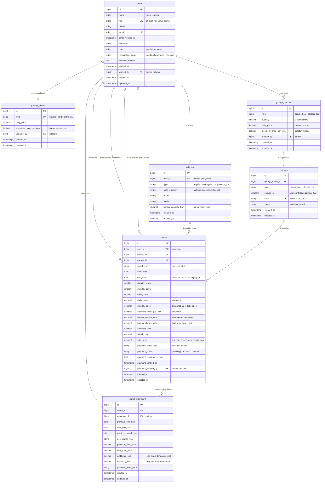

# ERD Garage Rental

ERD ini mengikuti skema database yang ada di `database/migrations` (tabel framework seperti `cache`, `jobs`, `sessions` tidak digambarkan).

## Catatan

- Tidak ada tabel `penyewa`. Data penyewa (NIK, status verifikasi) ada di `users`, dibedakan lewat kolom `role`.
- Tidak ada tabel `tipe_garasi`. Tipe berupa kolom `type`, dan `garage_prices` menyimpan satu harga per tipe (relasi logis lewat `type`, bukan foreign key).
- Tidak ada tabel `pembayaran`. Bukti bayar ada di `rentals.payment_proof_path` (sewa awal) dan `rental_extensions.payment_proof_path` (perpanjangan).
- Status sewa (aktif/selesai) tidak disimpan, bisa diturunkan dari `end_date`.
