# Skenario Pengujian Garage Rental (Mermaid)

Dokumen ini memetakan seluruh skenario test otomatis di folder `tests/` dalam bentuk diagram Mermaid. Isinya dibaca langsung dari kode test, bukan dari asumsi.

**Bagian A: Unit test** (`tests/Unit`): 10 file, 106 method test.
**Bagian B: Feature / integration test** (`tests/Feature`): 4 file, 42 method test. Ini bukan unit test murni karena memanggil HTTP, seeder, dan scheduler. Bagian ini disertakan supaya gambaran pengujian lengkap.

## Ringkasan

| # | File test | Yang diuji | Jenis | Method | Kasus (termasuk data provider) | DB |
|---|---|---|---|---:|---:|---|
| A1 | `Unit/EnumsTest` | `VehicleType`, `GarageType`, `PaymentStatus` | murni (PHPUnit) | 6 | 17 | tidak |
| A2 | `Unit/RentalPeriodCalculatorTest` | `RentalPeriodCalculator` | murni (PHPUnit) | 17 | 36 | tidak |
| A3 | `Unit/Support/FormatTest` | `Format::rupiah` | murni (PHPUnit) | 1 | 8 | tidak |
| A4 | `Unit/Models/GarageTest` | model `Garage` | Laravel + DB | 13 | 22 | ya |
| A5 | `Unit/Models/RentalTest` | model `Rental` | Laravel + DB | 6 | 11 | ya |
| A6 | `Unit/Models/VehicleAndPricingTest` | `Vehicle`, `GarageBatch`, `GaragePrice` | Laravel + DB | 7 | 7 | ya |
| A7 | `Unit/Services/GarageBatchServiceTest` | `GarageBatchService` | Laravel + DB | 9 | 9 | ya |
| A8 | `Unit/Services/RentalBookingServiceTest` | `RentalBookingService` | Laravel + DB | 27 | 30 | ya |
| A9 | `Unit/Services/RentalExtensionServiceTest` | `RentalExtensionService` | Laravel + DB | 9 | 9 | ya |
| A10 | `Unit/Services/RentalReportServiceTest` | `RentalReportService` | Laravel + DB | 11 | 11 | ya |
| | **Total Unit** | | | **106** | **160** | |
| B1 | `Feature/GarageRentalSchemaTest` | skema, seeder, relasi, bentrok | Feature | 6 | 6 | ya |
| B2 | `Feature/PenyewaPortalTest` | portal penyewa (HTTP) | Feature | 14 | 14 | ya |
| B3 | `Feature/AdminPanelTest` | panel admin (HTTP) | Feature | 10 | 10 | ya |
| B4 | `Feature/BusinessRulesTest` | aturan bisnis end to end | Feature | 12 | 12 | ya |
| | **Total Feature** | | | **42** | **42** | |

Catatan teknis:

- Test yang memakai database memakai trait `RefreshDatabase` dan helper `Tests\Concerns\BuildsFixtures` (`garage()`, `vehicle()`, `rental()`, `adminUser()`, `penyewaUser()`). `rental()` menghitung biaya lewat `RentalPeriodCalculator`.
- Waktu dibekukan lewat `freezeToday()`: **Sabtu, 10 Oktober 2026 pukul 10:00 WIB**. Bulan Oktober punya 31 hari, jadi batas sewa harian maksimal 30 hari.
- `Storage::fake('public')` dipakai untuk semua test yang mengunggah bukti bayar.
- Kolom "Kasus" menghitung setiap baris data provider sebagai satu kasus. Satu method dengan data provider dihitung sekali di kolom "Method".

Cara membaca diagram: kotak biru adalah file test, kotak kuning adalah method test (`test_...`), dan kotak hijau adalah skenario atau assertion. Tanda `[X]` berarti skenario negatif, yaitu sistem harus menolak atau mengembalikan error. `[OK]` berarti skenario positif.

---

## Peta keseluruhan

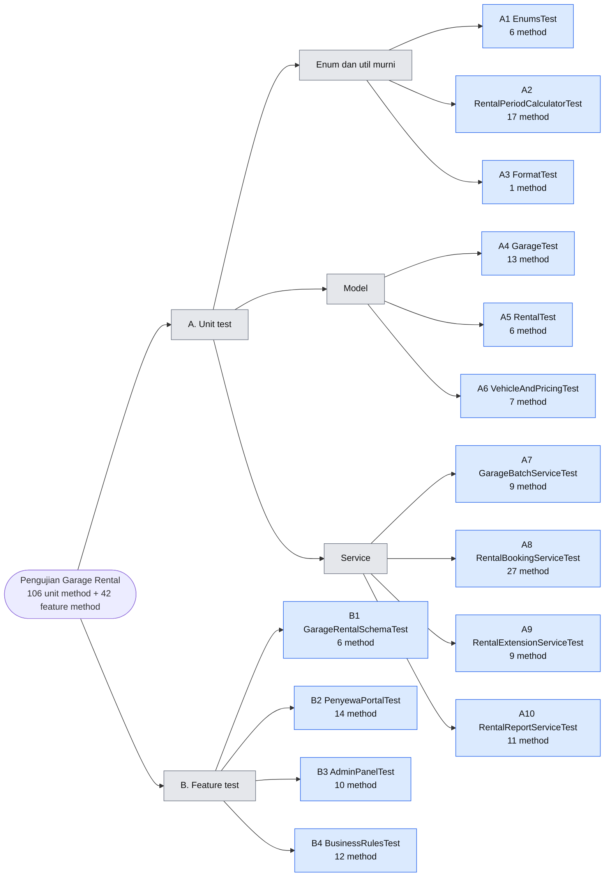

### Cakupan menurut kelas yang diuji

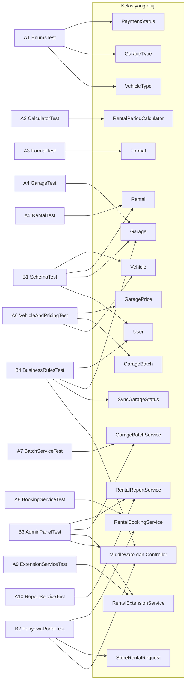

---

# Bagian A. Unit test

## A1. `EnumsTest` (6 method, 17 kasus)

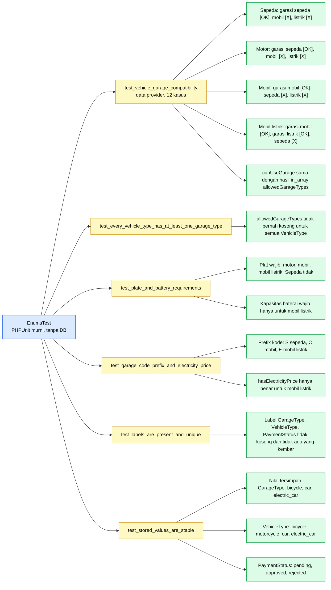

## A2. `RentalPeriodCalculatorTest` (17 method, 36 kasus)

Aturan inti yang diuji: ambang bulanan sama dengan jumlah hari di bulan tanggal mulai. Durasi di bawah ambang dihitung harian. Durasi sama dengan atau di atas ambang dihitung 1 blok bulanan (25 x harga harian) ditambah sisa hari harian.

```mermaid
flowchart LR
    S["RentalPeriodCalculatorTest<br/>PHPUnit murni, tanpa DB"]

    subgraph KLASIFIKASI["Klasifikasi harian atau bulanan"]
        T1["test_classify<br/>data provider, 8 kasus"]
        T1 --> T1a["Feb 2024 kabisat: 28 hari harian, 29 hari bulanan"]
        T1 --> T1b["Feb 2025: 27 hari harian, 28 hari bulanan"]
        T1 --> T1c["Okt: 30 hari harian, 31 hari bulanan"]
        T1 --> T1d["April: tepat 30 hari bulanan"]
        T1 --> T1e["Sehari harian"]

        T2["test_monthly_threshold_is_days_in_start_month<br/>data provider, 13 kasus"]
        T2 --> T2a["Jan 31, Feb 28, Feb kabisat 29, Mar 31, Apr 30, Mei 31, Jun 30"]
        T2 --> T2b["Jul 31, Agu 31, Sep 30, Okt 31, Nov 30, Des 31"]

        T3["test_threshold_follows_start_month_not_end_month"]
        T3 --> T3a["Mulai 25 Feb 2025 sampai 24 Mar: bulanan"]
        T3 --> T3b["Mulai 25 Mar 2025 sampai 21 Apr: harian"]

        T4["test_year_boundary"]
        T4 --> T4a["20 Des 2025 sampai 19 Jan 2026 (31 hari): bulanan"]
        T4 --> T4b["20 Des 2025 sampai 18 Jan 2026 (30 hari): harian"]
        T4 --> T4c["Akhir bulanan paling awal: 19 Jan 2026"]
    end

    subgraph DURASI["Durasi dan batas"]
        T5["test_single_rental_is_limited_to_one_month"]
        T5 --> T5a["Feb 2024: maksimal 29 hari, 30 hari ditolak"]
        T5 --> T5b["Oktober: maksimal 31 hari, 32 hari ditolak"]
        T5 --> T5c["Tanggal selesai sebelum mulai: ditolak"]

        T6["test_duration_is_inclusive"]
        T6 --> T6a["1 Okt sampai 1 Okt = 1 hari"]
        T6 --> T6b["27 Feb sampai 26 Mar 2024 = 29 hari"]

        T7["test_time_of_day_is_ignored"]
        T7 --> T7a["23:59:59 ke 00:00:01 hari berikutnya = 2 hari"]
        T7 --> T7b["Hari sama, jam berbeda = 1 hari"]

        T8["test_end_date_and_earliest_monthly_end_date"]
        T8 --> T8a["endDateForDays 1 Okt + 3 hari = 3 Okt"]
        T8 --> T8b["Akhir bulanan paling awal: 26 Mar 2024, 31 Okt 2025"]

        T9["test_start_at_month_end_crosses_into_next_month"]
        T9 --> T9a["Mulai 31 Jan 2025: 2 Maret"]
        T9 --> T9b["Mulai 31 Jan 2024 kabisat: 1 Maret"]
    end

    subgraph TANGGAL["Validasi tanggal mulai"]
        T10["test_start_date_cannot_be_backdated"]
        T10 --> T10a["Hari ini, besok, +7 hari: valid"]
        T10 --> T10b["Kemarin: tidak valid [X]"]

        T11["test_start_date_validation_uses_calendar_day"]
        T11 --> T11a["Pukul 23:30, tanggal hari ini pukul 00:00: valid"]
        T11 --> T11b["Kemarin 23:59: tidak valid [X]"]
    end

    subgraph BIAYA["Rincian dan biaya"]
        T12["test_breakdown_for_new_and_extended_rentals"]
        T12 --> T12a["10 hari: 0 bulan, 10 hari"]
        T12 --> T12b["31 hari: 1 bulan, 0 hari"]
        T12 --> T12c["Perpanjangan 1 Okt sampai 5 Nov: 1 bulan + 5 hari"]
        T12 --> T12d["1 Okt sampai 31 Des: 1 bulan + 61 hari"]
        T12 --> T12e["Feb 2024 kabisat sampai 31 Mar: 1 bulan + 5 hari"]

        T13["test_breakdown_edges"]
        T13 --> T13a["32 hari: 1 bulan + 1 hari"]
        T13 --> T13b["30 hari Okt: 0 bulan, 30 hari"]
        T13 --> T13c["Feb 2025: 28 hari bulanan, 27 hari harian"]
        T13 --> T13d["Perpanjangan 11 bulan: 1 bulan + 305 hari"]

        T14["test_rental_cost"]
        T14 --> T14a["3 hari = 300.000"]
        T14 --> T14b["1 bulan = 2.500.000 (25 x harian)"]
        T14 --> T14c["1 bulan + 5 hari = 3.000.000"]
        T14 --> T14d["92 hari = 8.600.000"]

        T15["test_cost_keeps_decimal_precision"]
        T15 --> T15a["12.500,50 x 3 hari = 37.501,50"]
        T15 --> T15b["Bulanan = 312.512,50"]
        T15 --> T15c["Harga 0 = 0,00"]

        T16["test_end_before_start_yields_nothing_billable"]
        T16 --> T16a["breakdown 0 bulan 0 hari, biaya 0,00, bukan dalam batas durasi"]

        T17["test_extension_cost_can_drop_when_crossing_into_monthly"]
        T17 --> T17a["30 hari harian 3.000.000 lebih mahal dari 31 hari bulanan 2.500.000"]
        T17 --> T17b["Selisih -500.000 (aturan harga yang diketahui)"]
    end

    S --> KLASIFIKASI
    S --> DURASI
    S --> TANGGAL
    S --> BIAYA

    classDef suite fill:#dbeafe,stroke:#2563eb,color:#111;
    classDef test fill:#fef9c3,stroke:#ca8a04,color:#111;
    classDef leaf fill:#dcfce7,stroke:#16a34a,color:#111;
    class S suite;
    class T1,T2,T3,T4,T5,T6,T7,T8,T9,T10,T11,T12,T13,T14,T15,T16,T17 test;
    class T1a,T1b,T1c,T1d,T1e,T2a,T2b,T3a,T3b,T4a,T4b,T4c,T5a,T5b,T5c,T6a,T6b,T7a,T7b,T8a,T8b,T9a,T9b,T10a,T10b,T11a,T11b,T12a,T12b,T12c,T12d,T12e,T13a,T13b,T13c,T13d,T14a,T14b,T14c,T14d,T15a,T15b,T15c,T16a,T17a,T17b leaf;
```

## A3. `FormatTest` (1 method, 8 kasus)

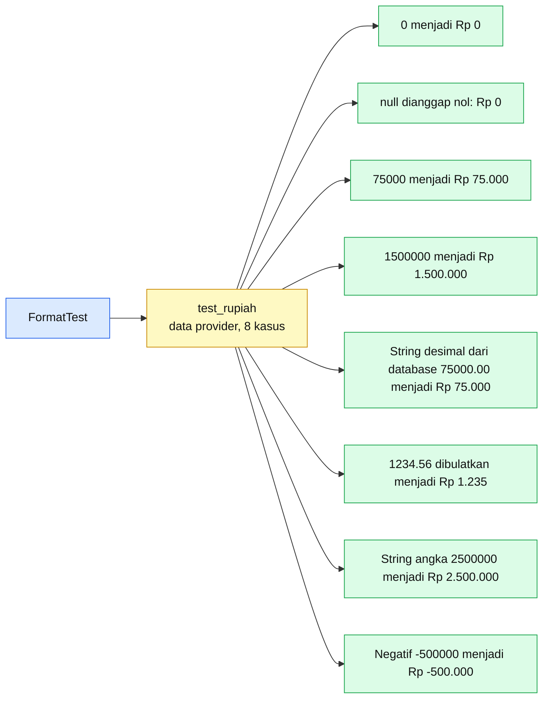

## A4. `GarageTest` (13 method, 22 kasus)

Data uji: sewa terisi pada 20 s.d. 22 Okt 2026. Hari ini dibekukan di 10 Okt 2026.

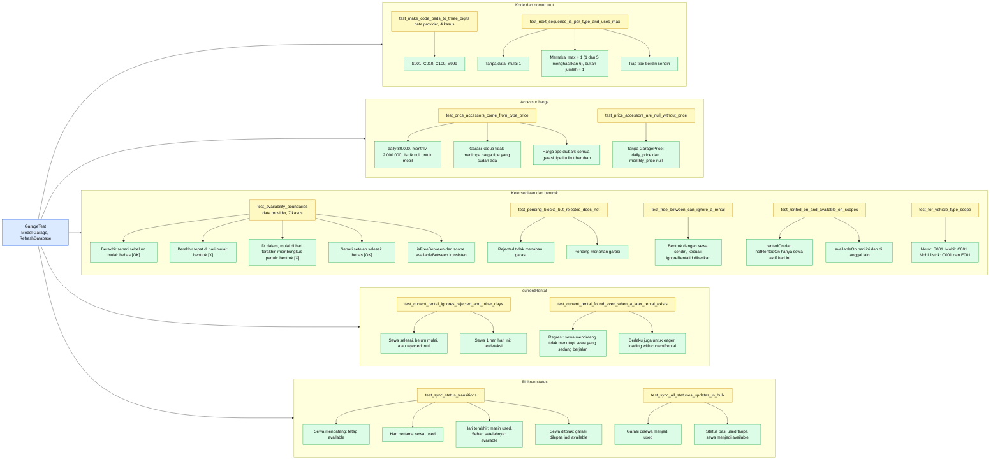

## A5. `RentalTest` (6 method, 11 kasus)

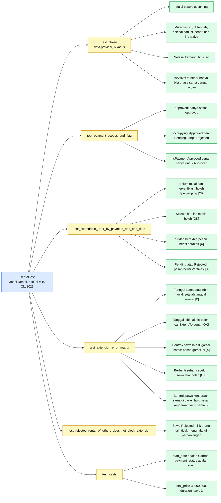

## A6. `VehicleAndPricingTest` (7 method)

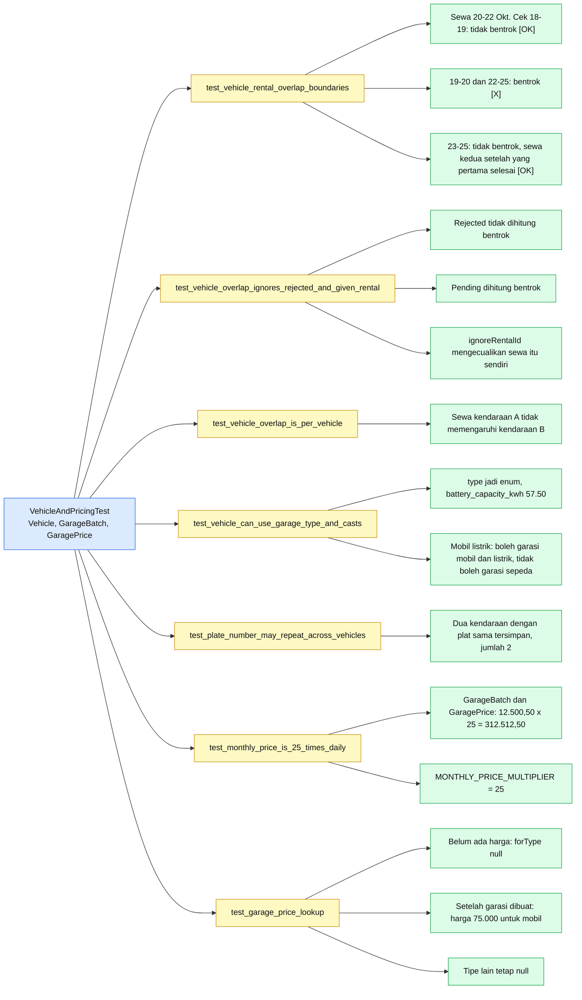

## A7. `GarageBatchServiceTest` (9 method)

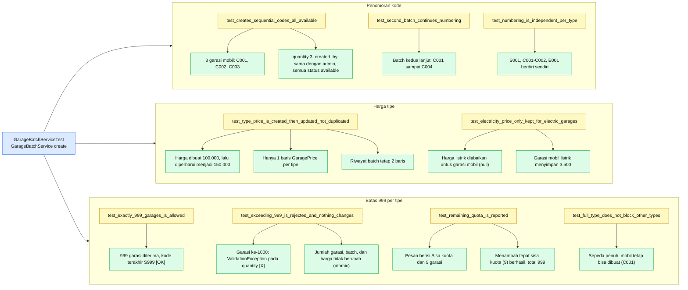

## A8. `RentalBookingServiceTest` (27 method, 30 kasus)

Data uji: hari ini 10 Okt 2026, penyewa disetujui, garasi mobil C001 harga 100.000/hari. Dibagi dua diagram: `quote` (hitung dan validasi) dan `book` (simpan transaksi).

### A8.1 `quote` dan `quoteForJson`

```mermaid
flowchart LR
    S["RentalBookingServiceTest<br/>quote, quoteForJson"]

    subgraph TGL["Tanggal dan durasi"]
        T1["test_max_daily_days<br/>data provider, 4 kasus"]
        T1 --> T1a["Okt 30, Apr 29, Feb 2027 27, Feb 2028 kabisat 28"]
        T2["test_valid_daily_quote"]
        T2 --> T2a["Tanpa error, selesai 12 Okt (inklusif), 3 hari"]
        T2 --> T2b["Total 300.000, listrik 0,00, max_daily_days 30"]
        T3["test_valid_monthly_quote"]
        T3 --> T3a["Mulai 15 Okt selesai 14 Nov (31 hari), 1 bulan, total 2.500.000"]
        T4["test_start_date_cannot_be_in_the_past"]
        T4 --> T4a["Kemarin: error start_date, costs dan end null [X]"]
        T5["test_start_date_limited_to_30_days_ahead"]
        T5 --> T5a["+30 hari: valid [OK]"]
        T5 --> T5b["+31 hari: error start_date [X]"]
        T6["test_daily_days_bounds"]
        T6 --> T6a["0 dan 31 hari: error days [X]"]
        T6 --> T6b["1 dan 30 hari: valid [OK]"]
        T7["test_daily_days_bound_shrinks_in_short_month"]
        T7 --> T7a["Feb 2027: 28 hari ditolak, 27 hari diterima, max 27"]
        T8["test_missing_inputs_do_not_crash"]
        T8 --> T8a["Input kosong: end, costs null dan garages kosong"]
        T8 --> T8b["Tanggal bukan-tanggal: error start_date"]
    end

    subgraph GRS["Kendaraan, garasi, dan bentrok"]
        T9["test_incompatible_garage_type_is_rejected"]
        T9 --> T9a["Mobil di garasi listrik: error garage_type dan garage_id, costs null"]
        T10["test_motorcycle_cannot_take_car_garage"]
        T10 --> T10a["Motor di garasi mobil: error garage_id [X]"]
        T11["test_garage_list_excludes_occupied_but_not_rejected"]
        T11 --> T11a["Daftar garasi hanya C002 (C001 terisi, sewa Rejected tidak menahan)"]
        T12["test_occupied_garage_is_rejected"]
        T12 --> T12a["Garasi bentrok di 11 Okt: error garage_id, costs null [X]"]
        T13["test_garage_list_empty_without_garage_type"]
        T13 --> T13a["Tanpa garage_type: daftar garasi kosong"]
        T14["test_unknown_garage_is_rejected"]
        T14 --> T14a["garage_id 99999: error garage_id [X]"]
        T15["test_cannot_use_someone_elses_vehicle"]
        T15 --> T15a["Kendaraan milik penyewa lain: error vehicle_id [X]"]
        T16["test_vehicle_overlap_is_rejected_but_back_to_back_is_fine"]
        T16 --> T16a["Kendaraan sama mulai 12 Okt (bertumpuk): error vehicle_id [X]"]
        T16 --> T16b["Mulai 13 Okt (berurutan): valid [OK]"]
        T17["test_booking_fails_when_type_has_no_price"]
        T17 --> T17a["Tanpa GaragePrice: error garage_id, costs null [X]"]
    end

    subgraph LST["Biaya listrik mobil listrik"]
        T18["test_electricity_cost_is_capacity_minus_current_battery_times_price"]
        T18 --> T18a["57,5 - 15 = 42,5 kWh x 3.000 = 127.500, total 367.500"]
        T18 --> T18b["Baterai penuh: listrik 0,00"]
        T18 --> T18c["Baterai kosong: 172.500 (kapasitas penuh)"]
        T18 --> T18d["Mobil listrik di garasi mobil biasa: listrik 0 dan tanpa error baterai"]
        T19["test_current_battery_is_required_and_cannot_exceed_capacity"]
        T19 --> T19a["Sisa baterai kosong: error battery_current_kwh [X]"]
        T19 --> T19b["Sisa 50,5 lebih dari kapasitas 50: error [X]"]
        T19 --> T19c["Nilai abc: error [X]"]
        T20["test_saved_electric_vehicle_uses_its_own_battery"]
        T20 --> T20a["Kendaraan tersimpan 40 kWh, sisa 10: listrik 90.000, charge 30,00"]
    end

    subgraph JSN["Format JSON"]
        T21["test_quote_for_json_shape"]
        T21 --> T21a["end_date 2026-10-12, duration 3, total Rp 300.000"]
        T21 --> T21b["has_electricity false, allowed_garage_types car"]
        T21 --> T21c["Garasi C001: harian Rp 100.000, bulanan Rp 2.500.000"]
    end

    S --> TGL
    S --> GRS
    S --> LST
    S --> JSN

    classDef suite fill:#dbeafe,stroke:#2563eb,color:#111;
    classDef test fill:#fef9c3,stroke:#ca8a04,color:#111;
    classDef leaf fill:#dcfce7,stroke:#16a34a,color:#111;
    class S suite;
    class T1,T2,T3,T4,T5,T6,T7,T8,T9,T10,T11,T12,T13,T14,T15,T16,T17,T18,T19,T20,T21 test;
    class T1a,T2a,T2b,T3a,T4a,T5a,T5b,T6a,T6b,T7a,T8a,T8b,T9a,T10a,T11a,T12a,T13a,T14a,T15a,T16a,T16b,T17a,T18a,T18b,T18c,T18d,T19a,T19b,T19c,T20a,T21a,T21b,T21c leaf;
```

### A8.2 `book`

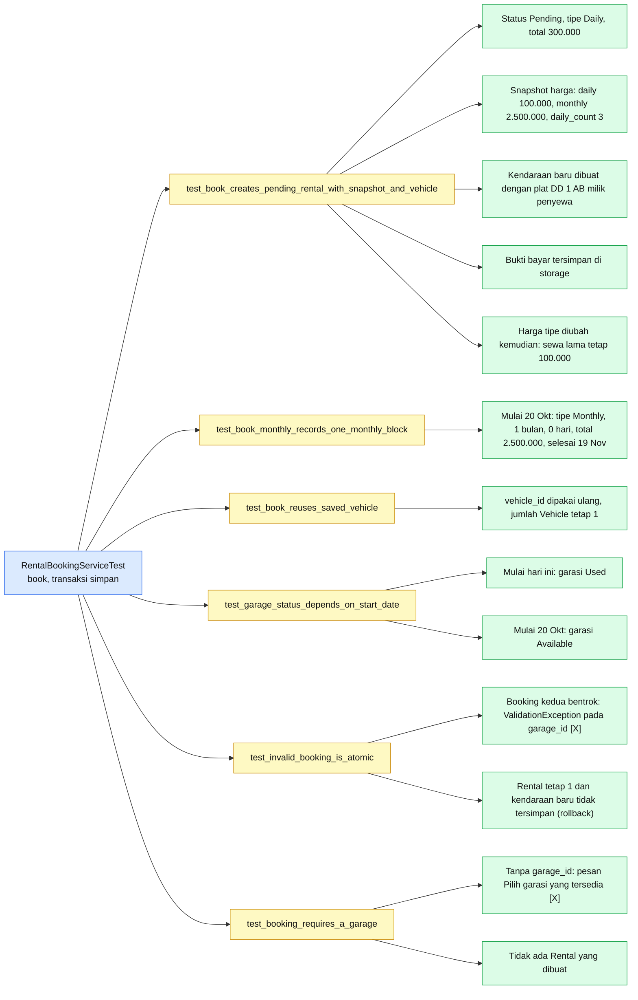

## A9. `RentalExtensionServiceTest` (9 method)

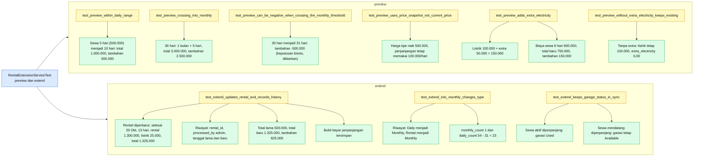

## A10. `RentalReportServiceTest` (11 method)

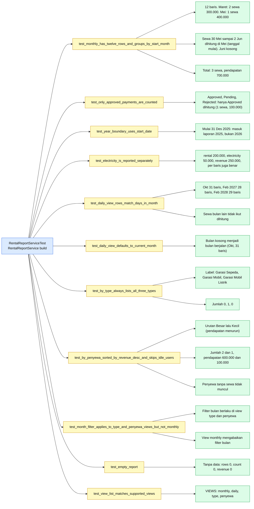

---

# Bagian B. Feature / integration test

Test di bagian ini memanggil rute HTTP, seeder, dan scheduler. Karena itu bukan unit test murni, dan dipisahkan dari Bagian A.

## B1. `GarageRentalSchemaTest` (6 method)

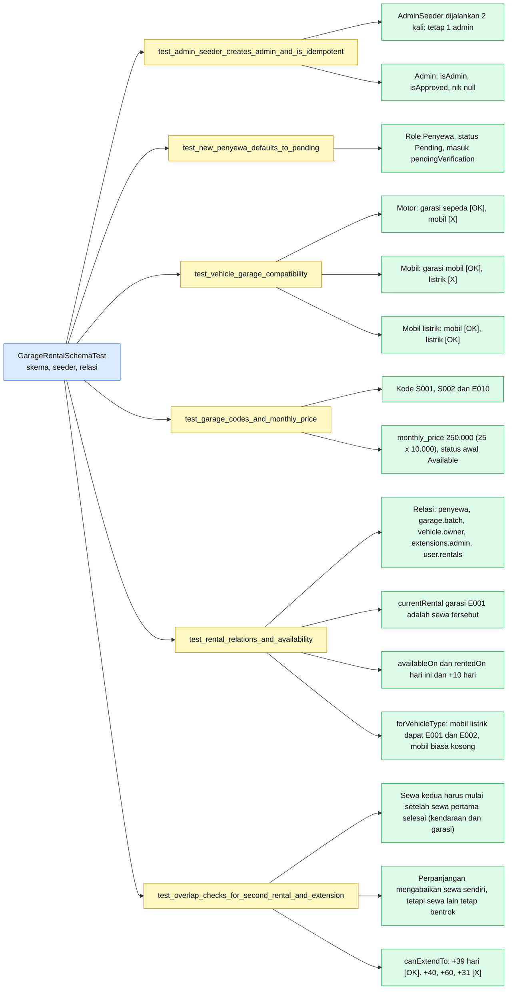

## B2. `PenyewaPortalTest` (14 method)

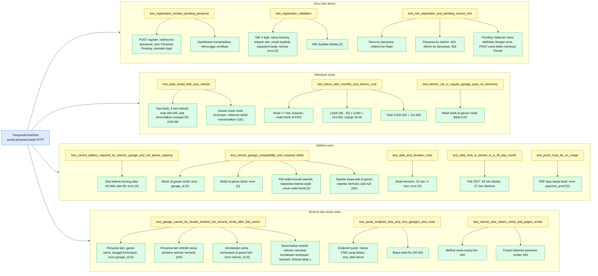

## B3. `AdminPanelTest` (10 method)

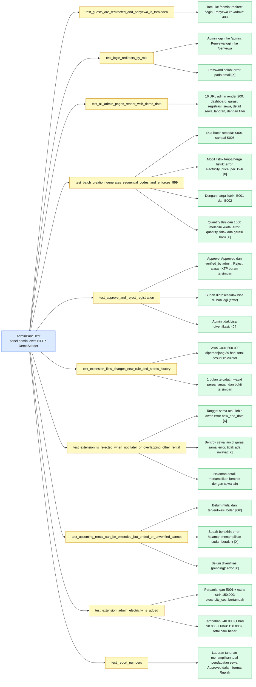

## B4. `BusinessRulesTest` (12 method)

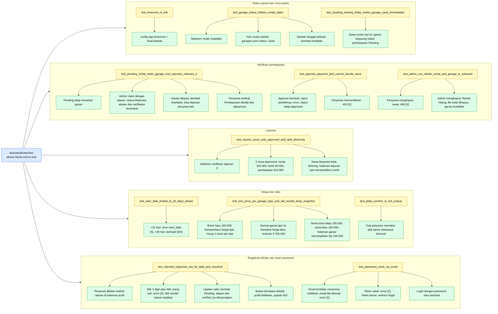

---

## Matriks aturan bisnis dan test yang menutupinya

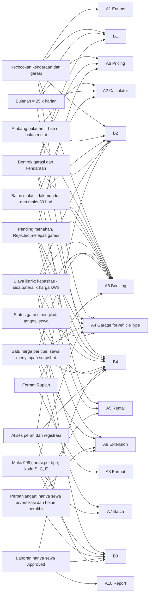
